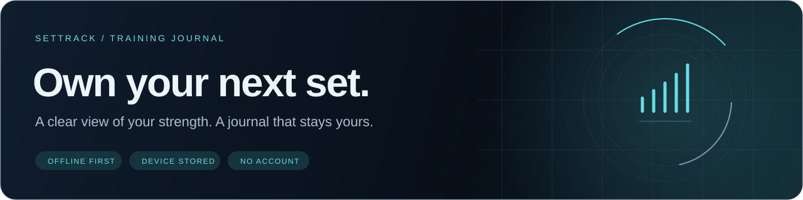
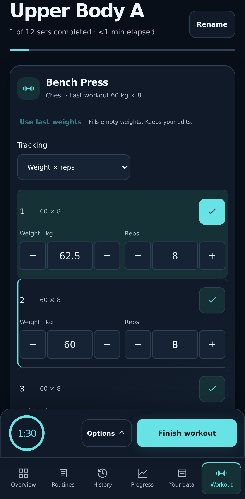

<p align="center">
  
</p>

<h1 align="center">SetTrack</h1>

<p align="center">
  <strong>Log your sets. See your progress. Keep your data.</strong><br />
  An offline-first strength-training journal with a cyan training cockpit, light and dark themes, and no account to create.
</p>

<p align="center">
  <a href="https://naumansaeed0.github.io/settrack/"><strong>Open SetTrack ↗</strong></a>
  &nbsp; · &nbsp; <a href="#between-sets">Features</a>
  &nbsp; · &nbsp; <a href="#run-it-locally">Quick start</a>
  &nbsp; · &nbsp; <a href="#go-deeper">Documentation</a>
</p>

<picture>
  <source media="(prefers-color-scheme: light)" srcset="docs/screenshots/overview-light.png" />
  
</picture>

## Between sets

| Plan your training | Log with less friction | Understand your progress |
|---|---|---|
| Create reusable routines or start a blank workout | Weight × reps, bodyweight reps and timed sets | Last-seven-day totals, weekly streaks and personal bests |
| Repeat a past workout with fresh, unchecked sets | Large steppers, last-workout weights and kg/lb units | Exercise charts, accessible tables and history filters |
| Edit workouts and delete sets with confirmation | Radial rest timer, optional alerts and screen wake lock | Records recalculated when history changes |

Built for the phone in your hand: bottom navigation, 44 px minimum tap targets, reduced-motion support and bundled offline fonts. The same journal works on desktop.

<details>
<summary><strong>See workout entry and exercise progress</strong></summary>

<p align="center">
  
</p>


Screenshots come from the production preview using `npm run screenshots`.

</details>

## Start with your own journal

The **Demo journal** is a separate sample journal for trying the app. Choose **Use my journal** to start with your own empty history, then create a routine or use an editable starter routine. The app remembers your choice. A demo draft can be moved to **My journal** before finishing, without overwriting an existing personal draft.

SetTrack stores your journal in **this browser on this device**. There is no backend, analytics or automatic cloud sync. Clearing browser data or storage eviction can remove it, so keep an off-device backup.

## Your data, your copy

Open **Your data** to check storage health, see your last backup and move your training between devices.

| Action | What it does |
|---|---|
| **Back up my journal** | Saves routines, completed workouts and the active draft in one full-fidelity file |
| **Restore from backup** | Validates the file, previews its contents and asks before replacing the selected journal |
| **Undo import** | Restores the journal saved immediately before the last backup restore or CSV import |
| **Export to spreadsheet** | Downloads completed history as an Excel-friendly CSV; excludes routines and drafts |
| **Import from spreadsheet** | Previews valid rows and merges new workouts; skips existing workout IDs |
| **Share this workout** | Shares a readable workout summary, with copy/selectable-text fallbacks |

Full backups use `.settrack`, with `.json` and `.txt` sharing fallbacks. Legacy v1/v2 backups remain supported. CSV is for spreadsheets; use a full backup to preserve exact entry values. [Read the backup and CSV guide →](docs/data-guide.md)

## Under the hood

| Layer | Technology |
|---|---|
| Interface | React 19 + TypeScript 5.9 |
| Build | Vite 6, deployed as static files |
| Journal | IndexedDB with migrations and local draft recovery |
| Offline app | Web App Manifest, service worker and consent-based update prompt |
| Design | Semantic CSS tokens, Space Grotesk and IBM Plex Mono; self-hosted fonts |
| Verification | Node test runner, Playwright, axe and Lighthouse |

## Run it locally

Use **Node.js 24 or later**.

```sh
npm install
npm run dev
```

For a production preview:

```sh
npm test
npm run build
npm run preview
```

Open **http://localhost:4173/settrack/**. To run browser checks, install Chromium with `npx playwright install chromium`, then run `npm run test:e2e`.

## Publish without GitHub Actions

Commit your changes, then run `npm run deploy`. The command requires a clean working tree, runs the unit tests, builds the app and publishes `dist/` to **`gh-pages`**.

**`main` is source. `gh-pages` is the published build.** Keep both: deployment synchronizes them by building and publishing, rather than merging their different contents. [Deployment and branch guide →](docs/deployment.md)

## Go deeper

- [Data, backups and CSV formats](docs/data-guide.md) — storage guarantees, restore safety, file formats and sharing.
- [Architecture and maintenance](docs/architecture.md) — source map, naming conventions, migrations and verification.
- [Deployment and branches](docs/deployment.md) — manual publishing, release checks and repository settings.

Browser support determines wake lock, sound, vibration and sharing. Background timers can be delayed; iOS can evict website storage. Physical-device behavior remains unverified. Cloud sync, custom exercises and platform notifications are future work.
