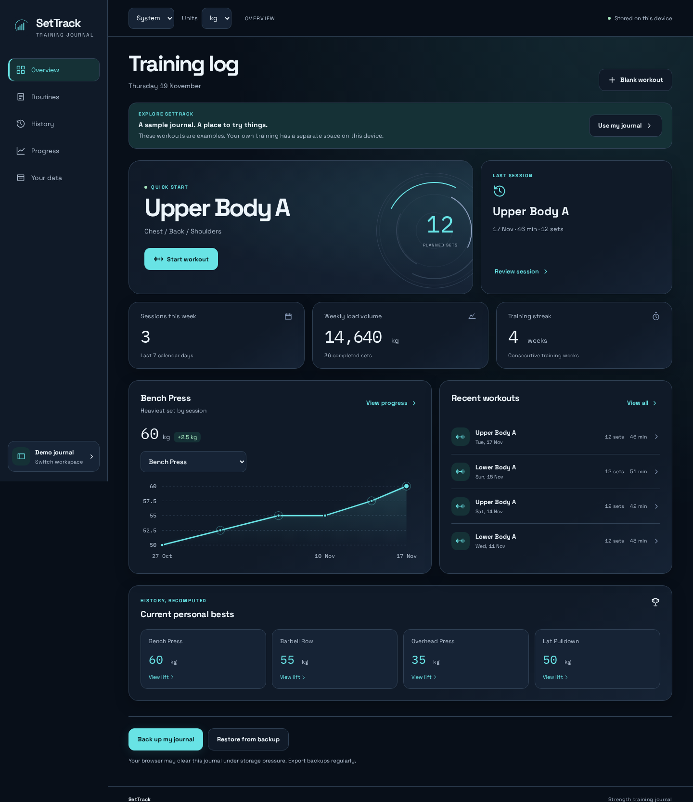
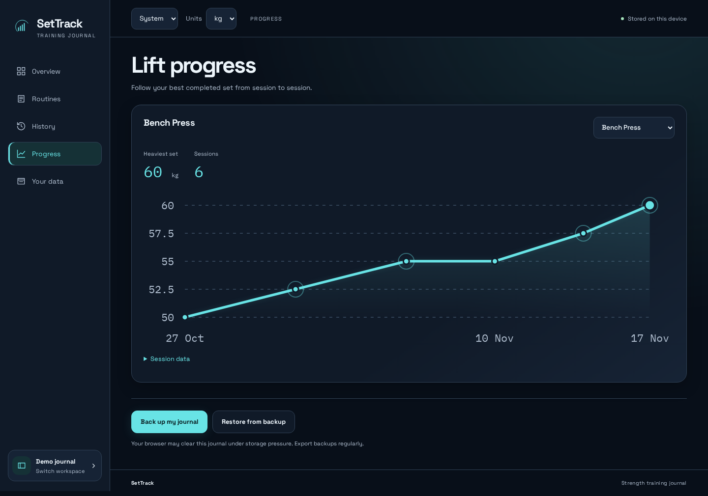

# SetTrack

**Your training. Your device. Your next personal best.**

[Open SetTrack](https://naumansaeed0.github.io/settrack/) — an offline-first strength-training journal built with React 19, TypeScript and Vite. No account, backend, analytics or cloud database. The interface follows your system theme, with manual light/dark controls.

## A training cockpit that works between sets

- Build routines, start a free workout, or repeat a past session with fresh unchecked sets.
- Log weight × reps, bodyweight reps, or timed sets in seconds. Pull-ups, dips and planks are included in the exercise library.
- Fill empty weights from your last session without overwriting edits. Added sets reuse the last valid values. Use large steppers or type directly; kg/lb preferences are separate per workspace.
- Name drafts, remove sets/exercises with confirmation, and edit or delete past sessions.
- Use a compact radial rest timer on phones, expandable controls, optional wake lock, and sound/vibration where supported.
- Search history by workout/exercise, filter 7/30/90 local calendar days, and inspect lift charts with PR markers and a data-table fallback.
- See weekly load volume, training-week streaks, the last session and personal bests computed from history. Deleting or editing a workout recomputes records.

The **Demo journal** is sample data. **Use my journal** opens a separate empty personal workspace with optional editable starter routines. Choosing a starter routine does not copy sample workouts. The app remembers your workspace; explicit `?workspace=demo` or `?workspace=personal` links override the preference. Before finishing in Demo, the app warns and offers to move the draft to My journal. It will not overwrite an existing personal draft.

## Screenshots






[Light theme screenshot](docs/screenshots/overview-light.png)

Captures are generated with Playwright using `npm run screenshots` against the production preview.

## Your data: device storage, not cloud sync

Routines, completed workouts and the active draft live in **this browser profile on this device**. Clearing site data or uninstalling can delete them. Another browser or device does not receive a copy automatically. iOS may evict website data, especially when the site is not added to the home screen. Installing the PWA helps usability but is not a substitute for backups.

**Your data** shows the persistence request result, the browser's storage estimate and the last full backup date. Storage estimates include cached app files and may include other pages on the same origin. Persistent storage is requested, not guaranteed. Private-mode/blocked storage, quota failures and revision conflicts have actionable error messages; unsaved in-memory data remains available to back up.

Draft database writes debounce for 400 ms and flush on blur, hiding and page exit. A synchronous local recovery record protects pending edits during tab closure. A matching revision can be recovered on reopening. This is local recovery, not an off-device backup, and cannot protect against clearing all site data or arbitrary OS/storage failures.

A dismissible reminder appears after 14 days without a backup or 10 workouts not included in the last backup. On iOS outside standalone mode, the data screen suggests **Safari → Share → Add to Home Screen**.

## Back up, restore, export and share

### Back up my journal

Creates one full-fidelity file containing the selected workspace's routines, history and draft. Export each workspace separately. Units, theme, timer duration and backup-reminder settings are device preferences, not journal data.

File sharing tries `SetTrack-backup-YYYY-MM-DD.settrack` with `application/octet-stream`. If `navigator.canShare({ files })` or the share call rejects that representation, it tries `.json` / `application/json`, then `.txt` / `text/plain`. If sharing is unavailable, it downloads the `.settrack` file. Cancelling the share sheet does not mark a backup as successful. A completed share/download updates the workspace's last-backup setting.

The fallback branches are tested with simulated browser APIs. **Acceptance by physical Android/iOS share sheets and individual apps is UNVERIFIED.** Backups contain private training data; choose the destination yourself.

### Restore from backup

Accepts `.settrack`, `.txt` and legacy `.json` backups, up to 20 MB. It validates the format, version, journal structure, known exercises, IDs, dates and completed sets, then asks before replacing a workspace. Invalid files do not change the journal. Before replacement, the current journal is saved as one **pre-import safety snapshot** in the same database transaction. **Undo import** restores it and clears the snapshot. A subsequent import replaces the previous safety snapshot.

The current internal full-backup format is **v3**:

```json
{
  "app": "settrack",
  "version": 3,
  "journal": { "routines": [], "history": [], "draft": null }
}
```

Legacy **v1** uses `data` instead of `journal`; **v2** uses `journal` without typed-exercise fields. Both migrate to v3; real fixture files are under `tests/fixtures/`. Valid v3 files are accepted. Unknown future versions are rejected with a clear message rather than crashing.

### Export to spreadsheet / Import from spreadsheet

CSV contains **history only**. It cannot represent routines or an active draft. Export uses UTF-8 with a BOM for Excel, standard quoted CSV fields, and spreadsheet-formula escaping. Names with commas, quotes and line breaks round-trip. Display weights are exported in the selected unit with two decimal places; use a full backup when exact original entry data matters.

One row represents one completed set. The exact column order is:

| Column | Meaning |
|---|---|
| Workout ID | Stable workout identifier used to skip existing workouts |
| Date | Finish time as ISO 8601 |
| Started at | Start time as ISO 8601; must not be after finish |
| Workout | Workout name |
| Exercise ID | A built-in exercise identifier |
| Exercise | Matching human-readable exercise name |
| Type | `weight`, `bodyweight`, or `timed` |
| Set ID | Stable set identifier within the workout |
| Set number | Positive exercise-local set order |
| Weight | Non-negative weight in the stated unit |
| Unit | `kg` or `lb` |
| Reps | Integer 1–200 for rep-based sets; empty for timed sets |
| Seconds | Integer 1–86400 for timed sets |
| Is record | Informational `true`/`false`; records are recomputed on import |

Import validates every row, reports row-level errors and changes nothing if errors exist. The preview shows workout/set counts and duplicate counts before confirmation. It **merges** new workouts by stable workout ID, skipping existing IDs, preserving routines/draft, and taking a safety snapshot for undo. An existing workout is never overwritten by CSV.

### Share this workout

Workout details offer a plain-text summary suitable for WhatsApp or messages: name/date, exercises, sets and `[PR]` markers. It uses native text sharing where available and otherwise copies to the clipboard, with selectable text when clipboard access fails. Sharing does not create an account or send anything automatically to a specific service.

## Data model and implementation

- `src/training.ts`: pure training rules, validation, canonical unit conversion, exercise types, finish checks, local-date filters, records, weekly summary and streak calculations.
- `src/useJournal.ts`: journal state, debounced writes, save queue, revision checking, recovery and import undo.
- `src/journal.ts`: IndexedDB **database version 2**, object stores `workspaces` and `safety`. The tested v1→v2 migration preserves journals/revisions and adds explicit exercise types.
- `src/backup.ts`, `src/csv.ts`, `src/sharing.ts`, `src/data.tsx`: backup validation/migration, spreadsheet format, platform sharing and user-facing data controls.
- `src/overview.tsx`, `src/workout.tsx`, `src/history.tsx`, `src/ui.tsx`: views and shared components. Navigation uses hashes so static-host deep links reload correctly.
- `src/theme.tsx`, `src/styles.css`: semantic design tokens and theme choice. Space Grotesk and IBM Plex Mono Latin WOFF2 files are self-hosted, small, and cached offline; no font CDN.
- `src/sw.js`, `src/pwa.tsx`, `vite.config.js`: content-versioned offline shell, cache cleanup, and a waiting-worker update prompt. Updating waits for safe save state.

Each workspace stores `{ revision, journal }`, where a journal has routines, history and `draft | null`. Workouts/lifts/sets have stable IDs. Timestamps are milliseconds. Sets use string inputs so incomplete edits remain editable; weight is canonical kg, with optional original entered value/unit for exact display round-trips. Timed sets use `seconds` instead of reps. The 0–1000 kg canonical limit also applies to lb entries. Zero-weight progress uses reps. Records are never persisted.

**Maintenance rules:** keep training rules out of views; any DB schema change requires a version bump and tested migration; any full-backup format change requires a backup-version bump and continued v1/v2 import compatibility.

## Develop and verify

Node.js 24+ is required.

```sh
npm install
npm run dev
npm test
npm run build
npx playwright install chromium
npm run test:e2e
```

Production preview: `npm run preview` → `http://localhost:4173/settrack/`.

Tests cover migrations, fixtures, CSV round-trips/duplicate skipping, unit limits and partial inputs, records/date filters, incomplete finishes, reversible imports, tab-close recovery, revision conflicts, offline use and worker upgrades. Axe scans dashboard, workout, history, progress and Your data in both themes at desktop/phone sizes.

```sh
npm run audit       # mobile Lighthouse; preview must be running
npm run screenshots # Playwright screenshots; preview must be running
```

The audit script uses installed Chrome or `SETTRACK_CHROME=/path/to/chrome`. Detailed local audit output is written under `.notes/`.

## Deploy without GitHub Actions

Vite's base is **`/settrack/`**. Commit every change first:

```sh
npm run deploy
```

The `predeploy` hook rejects a dirty working tree, runs `npm test`, then builds. Failure stops deployment. The deploy command publishes only `dist/` to `gh-pages`, including `.nojekyll`, and removes legacy source/workflow files from that branch. GitHub Pages must use **Deploy from branch → gh-pages → / (root)**. No GitHub Actions workflow or billing setup is used.

Repository About fields require account permissions beyond code publishing. With an authorized account:

```sh
gh repo edit naumansaeed0/settrack \
  --description "Offline-first strength-training journal and PWA" \
  --homepage https://naumansaeed0.github.io/settrack/ \
  --add-topic react --add-topic typescript --add-topic vite \
  --add-topic pwa --add-topic fitness --add-topic offline-first --add-topic workout-tracker
```

## Known limitations / Roadmap

- No cloud sync or accounts. Multi-device sync would require a backend, such as Supabase or Firebase, and is out of scope for this implementation.
- No push-notification timers. Alerts can be delayed or unavailable when the PWA is backgrounded or the device is locked.
- iOS has no vibration API. Sound requires an interaction and is subject to browser audio policies.
- Wake lock is optional and can be denied or released by the browser/OS.
- Device storage can be evicted. Persistent storage and home-screen installation do not replace backups.
- Physical vibration, audible output, OS screen locking, native share destinations and real iOS behavior are **UNVERIFIED** by browser emulation.
- User-defined exercises, cross-device sync and platform notifications are future work.
